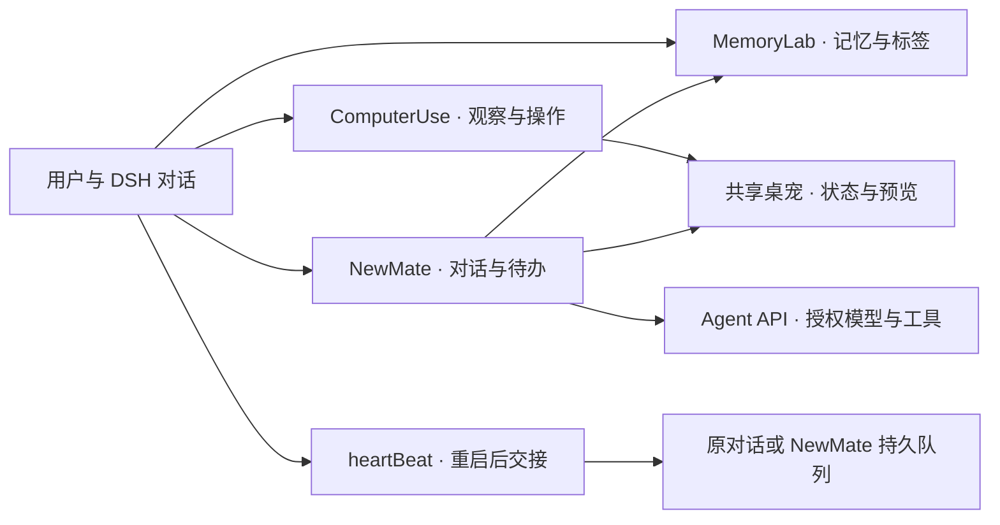

# Newmark2DSH

**让 DeepSeek Harness 记得你的项目、操作你的桌面，也拥有一位懂得适时出现的伙伴。**

Newmark2DSH 将 Newmark 的持久记忆、桌面自动化与私人秘书式陪伴带入 **DeepSeek Harness（DSH）**。你可以把项目背景和长期偏好留在 MemoryLab，让 Agent 借助 ComputerUse 处理图形界面工作，再由 NewMate 接住日常对话和定时待办；需要更新、重启后继续工作时，heartBeat 负责把已经登记的任务交回正确的对话。

一个自包含插件包，五个独立组件开关，一套默认位于 `~/.Newmark` 的本地用户库。模型沿用 DSH 已配置的供应商与授权选择，界面沿用宿主主题，桌宠由陪伴与 ComputerUse 共享。

[获取发布版本](https://github.com/positer/newmark2dsh/releases) · [npm 包](https://www.npmjs.com/package/newmark2dsh) · [项目结构](https://github.com/positer/newmark2dsh/blob/main/OVERVIEW.md) · [维护约定](https://github.com/positer/newmark2dsh/blob/main/taste.md)

## 从一次聊天，到持续的工作与陪伴

想象你正在维护一个长期项目：MemoryLab 留下项目约定和研究线索，下一次需要时可按标签找回；Dev 在代码仓库里规划、实现并整理记录；ComputerUse 打开只能通过窗口操作的应用；NewMate 根据已有记忆回应你，也能在约定时间激活一轮对话或发送原文提醒。更新宿主前登记后续任务，heartBeat 会在新进程就绪后交接，让下一次启动有明确的接续入口。

这些能力可以按需求组合使用：

| 组件 | 帮你完成什么 | 主要入口 |
| --- | --- | --- |
| **MemoryLab** | 保存、检索和整理长期知识，管理有到期标记的短期记忆 | MemoryLab 侧栏、记忆工具 |
| **ComputerUse** | 观察屏幕和应用，执行鼠标、键盘及窗口操作 | `computer_use`、`screen_capture`、原生接管提示与预览 |
| **Agent API** | 用统一接口发现工具、派发工具、调用授权模型完成一次 Agent 运行 | `agent_api_catalog`、`agent_api_tool`、`agent_api_send` |
| **NewMate** | 带记忆的对话、实时引导、低打扰主动联系与定时待办 | NewMate 侧栏、共享桌宠、对话工具、认证 MCP |
| **heartBeat** | 登记重启后任务，在宿主恢复后可靠交接并留下消费回执 | `heartbeat_after_restart`、`heartbeat_restart`、插件更新流程 |

另外随包提供 **Dev / rDev 两种 Agent 预设**。预设决定对话使用的工具组合，不计入五个组件开关。

## 五个子组件，逐一认识

### 🧠 MemoryLab：把值得记住的内容，变成可查找的知识

项目的命名约定、反复引用的理论推导、已经确定的个人偏好，都可以成为长期记忆。MemoryLab 用 Markdown 内容和标签关系组织这些信息，让 Agent 既能查到具体段落，也能了解一条记忆在知识图中的位置。

- **长期记忆与共享文件格式。** 默认使用 `~/.Newmark/Memory Lab`，包含索引、记忆正文、历史归档和操作记录，与 Newmark 用户库共用文件格式。可配置根目录。
- **可探索的标签图。** 总览展示知识关系，详细视图显示标签与关联记忆；支持搜索、拖动、缩放、选择和双向／父链／子树／直接四种关注方式。
- **按需检索。** 查询带结果数量和文本预算限制，支持读取记忆、获取根标签和子标签树，避免每次都把整座知识库塞进上下文。
- **可核对的更新。** 支持新建、追加和局部替换。修改前归档旧版本，用 `expectedUpdatedAt` 拒绝过时写入，重建索引并回读核对后才报告完成。
- **标签整理。** 确定性重建负责规范化与重复运行一致性；标签审阅与应用工具用于进一步整理关系，保留明确的修改记录。
- **短期记忆。** 默认七天到期，可指定到期时间。页面展示序号、存入与到期时间；过期内容灰显保留，召回返回最近十条并标注是否过期。

主要工具：`memory_lab_read`、`memory_lab_query`、`memory_lab_root_tags`、`memory_lab_subtag_tree`、`memory_lab_update`、`memory_lab_delete`、`memory_lab_reindex`、`memory_lab_tag_review`、`memory_lab_tag_apply`，以及 `shortMemory_add / recall / where / size`。

**一个例子：** 将“项目采用何种单位制、变量命名和误差定义”保存为带标签的记忆；下次讨论模型时按标签读取，并在结论变化后增量更新。NewMate 会自动取得标签图和最近短期记忆作为背景，具体长期正文仍按需查询。

### 🖥️ ComputerUse：让 Agent 看见窗口，也能动手操作

当任务走到图形界面，ComputerUse 提供从观察到操作的统一入口。它可以列出应用、观察窗口、等待变化、组合连续动作，也能执行点击、拖动、滚动、输入文本和组合键。

- **观察与操作分开。** `screen_capture` 只读采集，不改变接管租约；`computer_use` 负责观察、应用操作和接管生命周期。
- **完整与稀疏观察。** 完整观察提供当前画面；稀疏观察利用有界变化测量减少重复采集，需要具体画面时再做完整观察。Windows 可结合 UI Automation，macOS 可选择像素或 Accessibility（AX）通道。
- **真实与隔离桌面路径。** Windows 支持真实桌面与隐藏桌面，Linux 提供 X11 / Xvfb 路径；macOS 采用用户预先准备的 Mission Control Space 与 AX 操作，各平台的隔离程度见下表。
- **明确的接管归属。** 租约绑定调用者，冲突返回占用信息；停止与异常退出执行释放和清理。可用桌面路径还支持原进程窗口的呈现映射与推出／拉入，保留原进程身份。
- **看得见的工作状态。** 真实桌面接管使用黑白动态包边；共享桌宠显示相应状态，展开后可查看只读目标预览。预览用于了解进度。
- **用户优先。** macOS Space 输入等待用户键鼠空闲，操作后尝试恢复原前台窗口和鼠标；用户重新操作时让出。Space 共享用户输入，按键或滚动可能短暂激活目标窗口。

主要动作包括 `observe`、`app_list`、`app_observe`、`wait_for`、`sequence`、`takeover_start / stop`、`move`、`click`、`drag`、`scroll`、`type`、`key` 和应用级操作。

**一个例子：** 先观察目标应用，确认窗口和控件，再输入内容并回看结果；较长工作可通过桌宠预览查看进度，结束后释放接管。Windows 隐藏桌面与 macOS Space 的行为不同，应按平台选择路径。

### 🔌 Agent API：把模型和工具，接到同一套调用接口

Agent API 是组件间复用模型与工具能力的桥梁。NewMate 的推理也通过这条入口完成，因此它沿用 DSH 的模型解析、请求准备与标准流回复处理。

- **先发现，再调用。** `agent_api_catalog` 列出调用环境中的工具，`agent_api_tool` 派发具体工具，`agent_api_send` 发起带步骤与超时限制的 Agent 运行。
- **明确模型身份。** 按供应商与模型成对选择，同名模型保持隔离，复用宿主公开适配层；配置页可选择插件准用模型。
- **按任务提供工具。** 运行可配置允许／拒绝列表、工作目录和结构化输出，工具暴露范围与实际可派发范围会随回执返回。
- **视觉输入。** 对支持图像的模型，将图像接入宿主附件结构；完整 ComputerUse 捕获可进入视觉上下文，稀疏观察收据不冒充图像。
- **统一结果与错误。** 保留完整 JSON，返回 `ok`、`exit`、错误分类及调用范围等信息，方便调用方判断成功、拒绝或失败。
- **有界恢复。** 对尚未交付可用内容的特定传输故障进行有限重试；已经返回工具调用的失败流不自动重发，避免重复执行。

**一个例子：** 让一次独立运行读取指定记忆并返回结构化判断；调用方可核对所用模型、执行步骤和结果。PTC 模式下“列得出”与“可从此入口派发”可能不同，目录会报告这一区别。工具名单不能替代会话权限和操作系统沙箱。

### 🐾 NewMate：带着记忆，在合适的时候出现

NewMate 是一位亲近、务实的私人秘书式 Agent。它拥有独立聊天入口、持久任务队列和共享桌宠，可以回应你，也可以根据可信的新内容低频主动联系。

**日常对话**

- 原生注入 MemoryLab 标签图与最近短期记忆，每次推理前复核内容变化；长期正文按需读取。
- 当前轮运行时可以继续补充要求，输入作为实时引导在模型／工具边界生效；用户工作优先于后台任务。
- 支持只读历史与关注保护，结合阅读、草稿、输入和任务状态决定是否适合自动换新对话，旧记录保留。
- 回复中的真实文件链接在 NewMate 侧栏调用 DSH 已注册的原生预览；无法预览时定位到文件管理器。
- 自包含 HTML 可直接在回复内交互，支持按钮、输入、展开、源码查看和复制。脚本在隔离 iframe 内运行，不开放同源宿主访问或外部网络。

**低打扰陪伴**

- 提供主动开关、安静／适中／活跃频率、静默时段与暂停设置。输入、阅读、宿主工作、CU 忙碌等状态会延后后台激活。
- 有可信且有用的新内容才主动发信，通常保持简短；没有合适内容就安静，连续未回应会逐步降低打扰频率。
- 新消息通过共享桌宠气泡提示，完整正文留在聊天；主动消息不自动弹出主窗口。双击桌宠或点击消息可进入 NewMate。
- 桌宠沿用浅色／深色／系统主题，支持大小配置与右键设置入口；退出陪伴释放陪伴的所有权，CU 可继续使用共享桌宠。
- 可显式指定目录做浅层文件变化观察，默认不启用；以变化标记触发有界判断，文件事件可能合并或遗漏。

**定时待办 toDoList**

页面、任意 DSH 对话、NewMate 和认证 MCP 都可以创建、查询或取消待办。每项记录确定的带时区激活时间及内容，有两种到期方式：

| 方式 | 到期后的行为 | 适合的需求 |
| --- | --- | --- |
| `conversation`（新待办默认） | 在关注保护允许时，以原生记忆和已有上下文运行一轮 NewMate | “明天九点，结合已有计划帮我梳理今天要推进的事情” |
| `reminder` | 投递保存的原文，不额外调用模型 | “明天九点提醒我提交材料” |

待办复用静默、暂停、输入与阅读保护，陪伴关闭时等待开启，所以**到期表示最早可激活时间，不保证精确到秒送达**。稳定任务身份和消息回执用于防止重启后重复激活或提醒；失败和运行中崩溃不会自动重试，已有旧提醒保留原语义。

主要工具：`newmate_chat`、`newmate_task_status`、`newmate_memory_context`、`newmate_state`、`newmate_message`、`newmate_todo_add / list / cancel`、`newmate_mcp_info`。有宿主绑定的原对话时，`newmate_task` 可把具体后续任务交回该对话；模型参数不能另选目标。

NewMate 可以读取、新建和增量更新可信记忆、整理标签及添加短期记忆；其工具组合不开放记忆删除、任意 Shell 执行或 CU 操作。需要更广权限的工作由原 DSH 对话继续处理，记忆内容本身不会增加授权。

### 💓 heartBeat：让一次重启，有明确的交接点

heartBeat 负责持久化重启后任务与消费回执，也为插件更新流程提供宿主重启入口。

- **先登记后续任务。** `heartbeat_after_restart` 仅绑定调用它的当前 DSH 对话，目标身份从宿主取得。
- **等待新宿主就绪。** `heartbeat_restart` 发起全局重启，辅助程序核对新进程身份与路径后再交接登记任务。
- **投递需要持久化确认。** 对话接续等待宿主持久化屏障，使用固定消息身份处理恢复；失败保留任务和错误。
- **消费后不再重放。** 成功交接时移除可执行任务载荷，仅保留永久消费回执。交给 NewMate 表示其队列已接受，模型完成状态仍需查询。

**一个例子：** 更新插件前登记“重启后核对新版本并继续当前工作”；宿主恢复后，任务交回原对话。当前自动全局重启面向官方 **Windows DSH Desktop**，其他平台不要据此假定相同重启能力。

## Dev 与 rDev：按工作范围选择预设

两种预设都采用 **PTC 工具呈现**（`run_code` 与生成的工具 SDK），并要求先读取项目文档、完成后更新说明与归档，适合需要长期管理的软件与研究项目。

| 预设 | 共同能力 | 区别 |
| --- | --- | --- |
| **Dev** | 项目文件、命令、搜索、技能、规划、任务与子 Agent 等工具 | 额外提供 DSH 运行时组合检查、组合开发技能，以及有 profile 上下文时的插件管理 |
| **rDev** | 同一套项目工作工具与文档协议 | 去掉运行时组合检查、额外组合技能目录，禁用插件管理 |

在 DSH 对话的预设选择器中选用。插件配置页只管理组件与插件偏好，不提供 Dev 预设开关。rDev 缩小工具组合；实际文件权限、沙箱和审批仍由宿主会话决定。

## 快速开始

1. 在 DSH 配置好模型供应商，确认所选模型可用。
2. 通过 DSH 插件管理器安装 **`newmark2dsh@0.3.14`**。使用明确版本可避免宿主包龄策略选中较旧版本。
3. 打开 **Newmark Core** 配置页，选择插件准用的供应商／模型，并开启需要的组件。
4. 从侧栏打开 **MemoryLab** 维护记忆，或打开 **NewMate** 开始聊天；陪伴需要开启相应陪伴设置。桌面工作在支持的平台使用 `computer_use`。
5. 更换已经加载的后端或原生代码后重启宿主；官方 Windows 容器可使用启用的 heartBeat 完成交接。

五个组件分别可以启停，但组合能力有依赖：**NewMate 推理需要 Agent API，原生记忆背景需要 MemoryLab；桌宠功能复用 ComputerUse 的原生实现；自动更新重启需要 heartBeat。** 停用组件会释放对应入口、工具与运行资源，持久用户数据保留。

对话中的首次体验可以从这三件事开始：

> “请把这个项目已经确定的命名约定保存到 MemoryLab。”
>
> “先观察目标应用，告诉我当前窗口里有什么。”
>
> “明天上午九点提醒我提交材料，只发送原文提醒。”

外部 Agent 接入 NewMate 时，调用 `newmate_mcp_info` 获取 MCP 路径与本地凭证文件位置。使用宿主实际 HTTP 地址加 `/newmark-newmate/mcp`，通过 Bearer 凭证访问，并满足宿主自身鉴权。凭证应留在本地受保护环境。

## 平台支持与验证范围

| 平台 | 当前桌面路径 | 已有验证与使用前提 |
| --- | --- | --- |
| **Windows** | 真实／隐藏桌面、UIA 与像素观察、共享桌宠与窗口呈现；官方容器自动重启 | 0.3.14 官方 Windows DSH 安装与包内容核对，完整门禁及原生预览、菜单、待办、MCP、重启恢复检查；原生辅助程序使用系统 .NET Framework 编译并按源码缓存 |
| **macOS · Apple Silicon** | 像素／AX 双通道、用户准备的 Mission Control Space、共享桌宠与 normal CU 包边 | macOS 14／15／26 ARM 云端原生与网页矩阵、真实双 Space 夹具及 1x／2x 渲染检查；按所用通道授予 Accessibility／屏幕采集权限 |
| **Linux / WSLg · X11** | 真实 X11 应用观察与输入、带认证的 Xvfb 隔离会话、Qt 桌宠及呈现映射 | 已有 X11／WSLg 路径验证；依赖 Xvfb、xauth、Openbox、xdotool、wmctrl、Python Xlib／PIL／PyQt5；WSLg 路径针对 Linux GUI 应用，原生 Wayland 控制尚不支持 |

Mac 云端夹具验证不等于官方 Mac DSH 整机安装、实体键鼠时序、多屏／全屏组合或最低硬件性能验收；Space 也不提供完整输入隔离。跨平台保持相近的包边、桌宠比例与主题风格，原生菜单和物理像素表现会随平台与 DPI 变化。

[Mac 原生／网页矩阵](https://github.com/positer/newmark2dsh/actions/runs/38394193819) · [Mission Control 双 Space 矩阵](https://github.com/positer/newmark2dsh/actions/runs/38395064819) · [Mac 验收边界](https://github.com/positer/newmark2dsh/blob/main/MACOS-CANDIDATE.md)

## 本地数据与组件协作

默认数据根目录是 `~/.Newmark`。MemoryLab 长期与短期记忆、NewMate 状态和持久任务在这套用户库中保存；用户可以配置根目录。模型请求经 DSH 已配置的供应商发出，使用哪家模型由授权选择决定。



图中箭头表示能力协作关系。NewMate 与 CU 共享桌宠，但陪伴消息、CU 接管租约与各自启停状态分别管理。开启陪伴不等于给 NewMate 开放整台电脑操作权限。

## 项目结构与开发入口

公开 GitHub 仓库以可交付插件包为根目录：

```text
newmark2dsh/
├── index.js / client.js       宿主组合与网页界面
├── cordis.patch.yml           Core 装配及 Dev / rDev 预设
├── components/
│   ├── memorylab/             长短期记忆、索引、标签与工具
│   ├── computeruse/           平台自动化、原生桌宠与窗口呈现
│   ├── agent-api/             模型接入、Agent 运行与工具派发
│   ├── newmate/               聊天、关注保护、待办、MCP 与持久队列
│   └── heartbeat/             重启任务、交接和消费回执
├── lib/                       用户根目录、模型选择、状态与更新等公共模块
├── locale/                    界面本地化
├── docs/                      公开技术说明
├── scripts/                   发布检查与专项验证
├── .github/workflows/         CI 与发布流程
├── CHANGELOG-*.md             按版本保存的公开更新记录
└── README.md / OVERVIEW.md / taste.md
```

开发工作区中，这个插件包位于 `Newmark2DSH/packages/newmark-core/`，专项脚本与时间戳归档位于 `Newmark2DSH/scripts/` 和 `Newmark2DSH/archive/`。本地用户配置、会话、凭证及开发档案不属于公开包。

在公开仓库根目录可运行发布结构检查：

```sh
node scripts/check-release-bundle.mjs .
```

此检查核对五组件自包含装配，平台原生行为和真实模型运行需执行各自专项验证。更多文件职责见 [OVERVIEW.md](https://github.com/positer/newmark2dsh/blob/main/OVERVIEW.md)，后续文档与实现遵循 [taste.md](https://github.com/positer/newmark2dsh/blob/main/taste.md)。

## 当前版本与更新

**当前介绍基线：0.3.14，2026-10-14 核对。** 本版本带来 NewMate 待办的记忆驱动对话激活、Mac 包边与桌宠比例调整，以及 Windows 陪伴继承现有 CU 桌面。详细版本变化与验收说明见 [0.3.14 更新记录](https://github.com/positer/newmark2dsh/blob/main/CHANGELOG-0.3.14.md) 与 [GitHub Release](https://github.com/positer/newmark2dsh/releases/tag/v0.3.14)。

README 按当前功能维护；各次发布细节保存在版本记录中。文档更新不代表重新发布 npm 包或改变已经安装的版本。

## 许可与反馈

项目采用仓库中的 [LICENSE](https://github.com/positer/newmark2dsh/blob/main/LICENSE) 条款，**不是 MIT / Apache 等通用开源许可**。源码、文档、品牌与项目资产的使用及再分发须遵循实际许可；第三方依赖仍遵循各自许可。

欢迎通过 [GitHub Issues](https://github.com/positer/newmark2dsh/issues) 提交建议与可复现问题。报告时附上插件版本、DSH 版本、系统与复现步骤，分享日志前去除凭证、私人记忆和用户文件内容。
