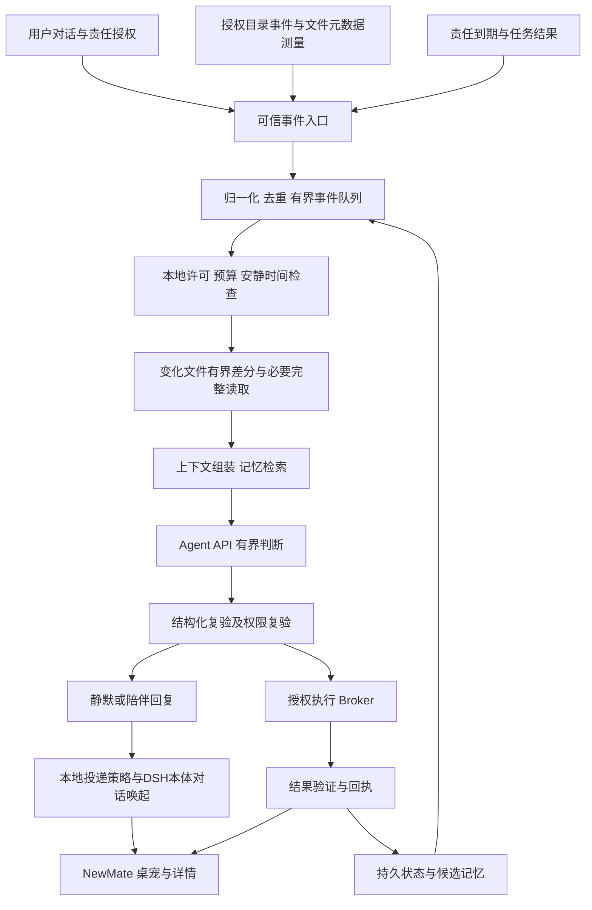

# newMate 陪伴型 Agent 内核设计

2026-10-11 · Newmark2DSH 新组件预研 · **提案，暂不实现**。

竞品与本地源码证据见 [调研](07-newmate-companion-research.md)。下文出现的 newmate 工具、目录、配置和状态都是拟议契约，当前没有注册或实现。

## 1. 内核边界与目标

newMate 拟作为 Core 的第四组件 `newmate`，复用 `agentApi` 的推理与工具接入、MemoryLab 的长期知识、ComputerUse 的观察与执行。用户可独立关停陪伴组件；关停不改动原有三个组件的行为。

首期目标：**MemoryLab驱动的定制陪伴、本地文件变化的稀疏测量、消极的主动响应，以及主动唤起DSH本体对话。** newMate主动链没有删除文件权限。用户明确：测量主要针对本地文件变动，读屏仅作可选任务辅助。常驻只在DSH活着时成立；休眠、关机、宿主退出均暂停。云运行、多伙伴、电话、钱包及跨设备投递另行设计。

预算、权限和暂停由本地代码执行；模型输出建议与回复。不得把人格提示词视为权限系统。

## 2. 结构与运行闭环



| 拟议模块 | 职责 | 明确边界 |
|---|---|---|
| Lifecycle | Cordis 挂载/卸载、停止信号、实例身份与租约 | 不是独立后台服务；卸载后不再采样或调模型 |
| EventIngress / Sentinel | 用户事件、责任到期、任务结果、授权本地文件变化 | 不越过目录白名单；正文是数据，不能改权限 |
| Scheduler | 合并、限速、优先级、安静时间、单 run 串行 | 不依赖桌宠绘制时钟；不能无上限 heartbeat |
| ContextBuilder | 固定人设、确认偏好、责任、有限近期交互、当前证据 | 不把整个历史与稀疏样本持续塞入提示词 |
| ApiAdapter | Presence/state/catalog、`agent_api_send`、必要的直接工具调用 | 不直接调用 Provider，不替换准用模型，不 `allow:['*']` |
| PolicyBroker | 按动作、资源、身份、授权版本重新检查与执行 | 工具名字许可不足以许可工具内部全部动作 |
| MemoryBridge / StateStore | MemoryLab 索引与事实引用、责任状态、恢复日志 | 候选观察与用户确认事实分开；不直接篡改 MemoryLab v2 文件 |
| PresencePresenter | 内核真实状态到桌宠/气泡/详情的投影 | 复用资产与视觉规则；陪伴显示和CU接管生命周期分离 |
| Audit / Delivery / HostChatBridge | 事件→判断→本体会话→结果追踪、幂等投递与导航 | 本体会话需真实宿主API；临时API run不能冒充DSH聊天 |

## 3. 本地文件稀疏测量与消极主动响应

### 3.1 主测量路径

继承CU的“便宜测量发现候选→必要时补足证据→语义判断”原则，将对象改为文件系统；**不通过截图判断文件变化，不轮询模型读全盘**。

对授权工作区F，轻量观测m(p)=(可得file identity、size、mtime、type)，OS事件合并成dirty集合D；责任相关集R={p∈D：路径允许且与用户责任有关}。元数据相同不证明内容相同，事件不保证完整；稀疏指选择少量变化文件、分层读取与有意义事件才触发推理，不是严格压缩感知。

| 层级 | 文件输入 | 决策与成本 |
|---|---|---|
| F0 | OS目录事件 | 无模型、无正文读取；只唤醒dirty queue |
| F1 | 变化路径元数据与manifest | 本地去重、范围/责任筛选，避免全树重读 |
| F2 | 有界字节/行diff、追加日志尾部、必要hash | 确认真正变化；完整hash仅用于需要精确证据的文件 |
| F3 | 必要完整内容与少量相关依赖 | 有界读取并核对版本；超限分批，不能裁掉后宣称完整 |
| F4 | 证据+MemoryLab定制上下文→Agent API | 本地判断无法完成且责任相关时才思考 |

首次授权分批建manifest，旧文件不当成新变化通知。默认排除node_modules、.git、构建缓存、临时文件和newMate运行文件，用户显式订阅可覆盖。watcher首选宿主兼容Node fs.watch/fsPromises.watch，能力按真实宿主Node版本验证，不强加升级。

Node官方列出跨平台差异、网络/虚拟化文件系统不可靠、filename缺失和inode替换边界；Windows目录通知缓冲溢出会丢记录，需要重建差异。事件是dirty提示，不是可靠事务日志。[Node文档](https://nodejs.org/api/fs.html#fswatchfilename-options-listener)、[Windows文档](https://learn.microsoft.com/en-us/windows/win32/api/winbase/nf-winbase-readdirectorychangesw)。

一致性规则：编辑器原子保存按父目录跟踪并重新解析最终对象；无法关联rename时按删除+新增，不伪造身份。连续写入debounce并检查稳定；读前后元数据不一致丢弃快照，有界重试。元数据一致也不是并发正确性证明，精确任务需要hash或应用快照协议。删除只记录tombstone，不能读取“已删除文件的当前正文”。junction/symlink、Windows大小写、路径移动、权限变化与TOCTOU都检查，实际读取不得逃逸授权根。

缺失filename、overflow、watcher错误、网络盘或休眠恢复将范围标为dirty_unknown，启动分批reconcile，不报告“无变化”。自身写入按run来源抑制重复，不永久忽略路径而漏掉用户后续修改。大文件不在主线程无限读/hash，所有IO有预算。

### 3.2 消极的主动响应

**被文件变化唤醒，但默认安静；不为了找话题而调用模型。** 无变化不思考，无关变化不读正文；相关但本地可判定时不调用模型；需要语义才思考；只有影响责任、明确失败或需要用户决策才唤起本体对话。模型思考后仍可silent。

本地结果：ignore / record_only / defer / think。文件变化不自动创造任务、编译修复或联系他人。用户主动输入和明确到期提醒不受“无文件变化不思考”的后台规则限制。

例：论文连续保存20次→稳定后合并一版；无关临时文件→忽略；订阅的实验结果到齐→先本地比对条件，解释确实必要才调API；失败标记→一次本体对话提醒并提供证据。定制语气、关切主题和责任相关性来自已确认MemoryLab内容。

拟议起始参数（未测量）：debounce 1秒、持续写入合并窗最多10秒，仍不稳定就defer；每批最多32文件、256KiB/文件与1MiB正文/批；manifest巡检5分钟一轮、分批最多1000条元数据/分钟。恢复队列同样有预算，不能因overflow全盘无界扫描。普通后台每小时最多6个模型run，通知预算另计。

### 3.3 成本与证据

对照为周期全树扫描+全量内容读取+定时模型。提案成本C=watch成本+stat次数×单次成本+读取字节×IO成本+hash成本+模型次数×模型成本+reconcile成本。验收闲置普通后台模型请求0、正文读取0，记录事件合并率、读取量、tokens、CPU/RSS、p50/p95响应延迟及丢事件恢复时间。巡检仍读元数据，不宣传零成本。

元数据/局部hash是有损测量，不保证无漏检。明确订阅的小文件或关键字不能因变化比例小被过滤掉。保存风暴、大树、大文件、rename/delete、overflow、网络盘、休眠与自身写入分别做对照；省开销不能以漏掉关键责任为代价。

### 3.4 可选CU辅助的原理来源与边界

以下屏幕公式只说明已有CU原理与按需辅助边界，**不属于newMate文件哨兵的默认采样链**。

令完整窗口图像为 \(x_t\)，灰度缩略测量为 \(y_t=M(x_t)\in\mathbb{R}^{576}\)。现有变化判断近似为：

\[
n_{24}=\sum_i[|y_t(i)-y_0(i)|\ge24],\quad
n_{64}=\sum_i[|y_t(i)-y_0(i)|\ge64],\quad
w_t=[n_{24}\ge4\ \lor\ n_{64}\ge2].
\]

`y0` 是**本次调用的首样本**。这是固定空间降采样与时间上的间歇测量，`M` 为非单射：两个语义不同的画面可以有相同灰度摘要。这里没有随机测量矩阵、稀疏先验、重构或恢复保证，不能称严格压缩感知。`w=0` 只能表示该观测器未触发，不能断言界面无变化、任务完成或用户情绪稳定。

变化量也不是信息价值。视频和光标闪动可造成频繁变化；小字错误与颜色状态变化反而可能漏检。因此触发链为：**粗变化候选 → 本地任务相关性检查 → 完整观察 → 模型语义判断 → 是否值得通知/行动**。

拟议测量层级：

| 层级 | 输入 | 模型调用 | 使用条件 |
|---|---|---|---|
| L0 | 用户输入、明确任务完成/失败、授权的本地事件 | 不必立即调用 | 优先使用结构化事件，保持无读屏模式可用 |
| L1 | 指定窗口32×18摘要 | 无 | 仅用户开启“看屏帮助”并绑定目标后启用 |
| L2 | 新鲜截图及有界UIA/平台语义证据 | 尚不必调用 | L1唤醒、责任需要画面、强制巡检或采样不确定 |
| L3 | 相关完整证据和上下文 | `agent_api_send` | 本地预算允许、确实需要理解或回复 |
| L4 | 授权工具结果和任务验证 | 按需 | 获准执行后闭环，不能以工具返回成功代替目标达成 |

采样失败/超时标为未知，不自动占用真实桌面接管来“修复”。仍有读屏许可且必要时补采L2；否则报告不可观察。DPI、几何、目标身份变化使基线和 `target_id` 失效，重新绑定观察，不沿用旧坐标。

现有每次 sparse wait 都返回，不是事件订阅；若循环调用且丢弃末次摘要，会漏掉两次调用间变化。P0实验需要决定：安全地输出/保留灰度数组跨轮比较，或在同一观测 worker 内提供可取消订阅；摘要哈希只能判相等，不能计算格差。不能在设计里假定这个桥已经有了。

看屏默认关闭、关闭时采样数为0；仅用户明确授权的电脑任务期间绑定窗口，短时采样与必要补采。任务之外不维持屏幕巡检，不将30秒读屏作为陪伴默认策略。显示锁定、用户暂停、越界或撤销许可即停采。平台能力分别验证。

稀疏待采预算、完整截图数量、模型次数分别记账。Win32当前初始化发生在内部5000ms等待预算之前，因此拟议 adapter 外层用单调时钟计总时限、传播取消并控制子 lane；首次冷启动与热态分别测量。超时返回≠worker已经停止，停止需要独立回执。

成本估算仅用于比较：固定读屏模型策略成本 \(C_b=N_f(c_f+c_m)\)；分层策略 \(C_n=N_sc_s+N_fc_f+N_mc_m+c_{sched}\)。实际 `c_s` 包含取像、跨进程、GDI/PrintWindow等待，不能按576/原图像素比例推导CPU或功耗节省。衡量模型调用减少、漏检、误唤醒、延迟和墙钟成本；不承诺固定百分比优化。

## 4. 状态机与责任驱动

运行状态和长期责任分开：

- 运行：`disabled → starting → quiet → observing → thinking → acting → quiet`；任意活动可到 `waiting_user / degraded / paused / stopping`。`waiting_user` 不轮询模型催促；用户新输入可抢占后台判断。`degraded` 不作成功宣告。
- 责任：`scheduled / ready / running / waiting_user / succeeded / failed / cancelled / suspended`。每项含用户来源、目标、成功条件、资源范围、时限、预算和到期策略。
- 一个伙伴允许多个责任排队，每个伙伴一个活动run。真实/虚拟CU槽保持现行用户级互斥；伙伴身份不意味着新槽。另一个DSH占有CU时转等待，不抢占。

事件优先级：停止/撤销、用户输入、失败/决策、到期责任、文件dirty与可选屏幕事件。队列容量提案128项，文件事件按规范路径/可得身份合并；关键停止不能丢弃，责任事件持久保存。文件事件溢出标记范围dirty并分批恢复，不静默漏掉。来源ID与版本去重。

安静时间默认22:00–08:00、普通主动提示每小时最多2条、同主题冷却30分钟。用户显式设定的紧急提醒和正在交互的回复可越过安静时间；这是确定性规则，不由模型自己宣布“紧急”。用户可修改这些参数。

后台判断起点为每小时最多6个模型run、最多3个模型turn/run、20秒外层deadline。主动聊天/明确执行另计预算，仍有硬上限。没有可调用准用模型、金额预算耗尽或用量未知超过保守token限制时停止模型推理，保留本地提醒和状态。不能让一个20秒run内的 Provider 重试突破外层停止语义。

## 5. 基于 Agent API 的真实接入契约

### 5.1 发现与调用

组件先通过工具registry presence确认 `agent_api_send`，再以 `agent_api_state/catalog` 获取当前能力与范围。工具可用不是模型可用；Component off、模型未选择、不可用和llm不可用分别展示。启用 newMate 不自动启用依赖，更不暗中选另一个模型。

使用现有进程内 `ctx.tools.execute` 入口；不发HTTP POST到只读 `/newmark-agentapi/state`，不调用 `ctx.subagents.start` 或新造DSH会话替代API。newMate的伙伴身份、长期对话和审计由自身持有，再把必要上下文写入每次 `prompt`。

判定run提案载荷（仅文档示意；只读门面尚未实现）：

```json
{
  "prompt": "版本化人设与用户边界；有限对话；责任和当前证据；请求陪伴决策JSON",
  "workspace": "C:/Users/12252/.Newmark/Work/newmate/<mate-id>",
  "timeout_ms": 20000,
  "max_steps": 3,
  "tools": {"allow": ["newmate_context_read"]},
  "output_schema": {
    "type": "object",
    "properties": {
      "decision": {"type": "string", "enum": ["silent", "reply", "suggest", "request_action", "ask_user"]},
      "text": {"type": "string"},
      "evidence_ids": {"type": "array", "items": {"type": "string"}},
      "action_request_id": {"type": ["string", "null"]}
    },
    "required": ["decision", "text", "evidence_ids", "action_request_id"],
    "additionalProperties": false
  }
}
```

`newmate_context_read` 拟为仅返回本run许可上下文的只读门面，每次检查宿主颁发的run身份，不接受模型指定别的用户/伙伴。不能把 `allow:[]` 当零工具模式：当前API会返回 `empty_tool_allow`。若后续选择零工具run，应先扩展并验证明确契约，不用遗漏过滤器作为替代。

不得省略 `tools` 使用默认memory前缀，因为该前缀包含更新、删除和重建。也不得把 `computer_use` 直接给后台判定run：名字级 allow 无法限制 action 参数。外部网页、UIA和聊天引用均标 `untrusted`，不能覆写固定人格、许可或执行规则。

API对结果做schema校验后，newMate仍应本地复验：有界text和数组、封闭枚举、所有证据ID属于当前run、action_request_id对应已有提案、输出不能新增许可。API不保证原生结构化生成；当前证据仅支持最终JSON解析和匹配验证，失败关闭，不能从自由文本提取“差不多的”动作。

### 5.2 权限与执行

进程级调用 `tool_reach=process`，以及PTC分支的进程级dispatch，不自动有会话guard/审批/sandbox。`workspace.enforced=true`只描述run工具上下文的工作目录，不是文件访问沙箱。

因此新建拟议 **PolicyBroker**：主机颁发不可由模型伪造的run身份；将用户许可绑定用户、伙伴、DSH调用会话、目标实例、动作类别、有效期、次数和版本。`owner_id` 文本不代替宿主会话身份。需要CU但不存在可信会话身份时，返回能力缺失，不能使用默认 `direct` 身份越过限制。

执行前检查三次：提案时、批准时、实际执行时。绑定动作参数摘要与资源身份；修改目标、参数或许可版本使批准失效。许可撤销传播AbortSignal并使未执行计划失效。已经发生的外部副作用不能靠abort回滚，须记录实际结果。

| 级别 | 许可范围 | 默认 |
|---|---|---|
| 对话 | 陪伴回复、用户输入的本地提醒 | 开启组件后可用 |
| 观察 | 指定窗口/目录/连接器的只读范围 | 看屏与连接器需明确配置 |
| 起草 | 约定工作区内生成待审查产物 | 责任授权后可用 |
| 执行 | 指定任务的CU动作或本地修改 | 对动作及资源作明确授权；不全局放行 |
| 外部影响 | 发送、购买、删除、权限更改等 | 首期不纳入自动后台动作；展示具体提案后按用户授权执行 |

模型只能返回 `request_action`。Broker将被批准的操作通过 `agent_api_tool` 的实际 `arguments` 调用限定工具；这一步仍是进程级执行，由Broker负责约束。若后续提供 `newmate_action_request` 工具，该工具只能生成提案，不能直接执行。禁止嵌套agent-api、任意shell、任意插件管理和无边界 `run_code`。

### 5.3 视觉输入 P0

当前API把工具结果转文本，不能证明CU截图进入模型视觉输入。首期可先使用结构化任务事件与UIA文字；视觉理解则需要**单独补充 Agent API 的类型化图像引用/视觉tool-result契约**：

1. CU生成新鲜证据，绑定目标、时间、几何和许可；图像引用带TTL、尺寸/字节上限、媒体类型与内容哈希。
2. 由API seam校验并转换为当前DSH Provider支持的视觉块；只送一次相关图像，不把base64写进长期prompt、记忆或审计。
3. 验证请求真正含image block、Provider接受、模型能辨认合成变化、引用到期/越权拒绝、取消回收；不能用模型自报“看到了”替代请求证据。
4. 模型不支持视觉时降级为文本帮助；不假装已理解画面，也不自动换未经准用的模型。

L2完整截图、UIA控件数量和视觉理解能力分别报告。隐藏桌面返回的子窗口枚举不应冒充完整UIA几何。视觉P0没闭环前，newMate不执行依赖截图判断的坐标动作。

### 5.4 主动唤起DSH本体对话（首期必要能力）

设计 `HostChatBridge`，实现伙伴对应的真实DSH会话绑定、系统来源消息注入和会话导航/提示。**本轮在现有newmark2dsh client中没有核实到可直接采用的会话创建/消息注入契约，属于P0宿主集成调查，不虚构接口名或端点。** Agent API不创建会话，不能承担本体对话唤起；仅桌宠气泡也不算验收。

拟议流程：许可事件→去重outbox→选取伙伴绑定会话（首次按组件启用时的明确约定创建）→宿主API注入 `source=newmate` 系统来源消息→取得真实session/message ID回执→按用户展示策略打开DSH并定位会话。不得伪造用户消息、覆盖当前输入框或以键盘自动输入作为注入替代。

唤起分为会话创建/续接、消息落入正式历史、导航展示/系统通知；唤起不自动授权会话执行。正在编辑/全屏/安静时优先未读与通知，明确待决策或用户配置的及时提醒才带到前台，避免每次保存文件抢焦点。用户允许的提醒上下文会随实际DSH会话guard工作，不能由API process权限透传为会话授权。

API固定JUDGE_SYSTEM_PROMPT说明没有用户可回答run内问题；因此模型返回ask_user只是结构化提案，由Bridge在本体对话询问，不能期待API run原地等待用户。人设不能覆盖该系统契约；定制响应由上下文与结构化text生成，本体持续交互走宿主真实对话。

宿主不支持创建/注入/导航时报告各项缺失，保留待发项和可点击入口，但标为降级、**未满足完整主动唤起验收**。宿主关闭时不自行起独立服务或强启进程；另行明确开机/外部唤醒授权才讨论冷启动。

### 5.5 主动删除的硬禁止

newMate所有自主/后台/定制人格链均不得删除文件或目录；模型、记忆、routine和普通执行批准不能扩大此边界。默认不暴露shell、通用fs写工具或任意CU动作；Broker拒绝unlink/rm/rmdir、清空/截断、替换覆盖造成旧内容丢失、移至回收站和通过CU删除。未知或不能证明无删除效果的动作失败关闭。起草默认新建版本化产物，修改已有文件需明确授权并保存可恢复前态，不能自发覆盖。

不能靠禁止命令关键词解决问题；通用shell、脚本与插件均可能间接删除，newMate主动工具面必须封闭为可证明的操作。用户本人在DSH本体明确提出删除时，由另一个具备其会话权限的普通执行上下文处理；newMate仍无主动删除权。记录外部发生的删除事件和处理自己的内存缓存不等于有文件删除权；自身历史清理也交用户管理或独立授权维护器，不由newMate主动unlink。

## 6. 长期状态、MemoryLab定制与恢复

MemoryLab是定制陪伴的核心来源：已确认偏好（称呼、语言、语气、提醒节奏）、项目背景、关切主题、长期目标与承诺，组织为可检索的伙伴profile引用。每次API判断只检索当前事件相关条目，附来源、版本与确认状态，用户纠正应同步改动后续回复和响应策略。固定最低规则由代码执行，MemoryLab不能授权删除、放开路径或绕过安静策略。

不训练用户专属模型，不另建平行知识库；profile.json存ID/版本/引用，定制事实以MemoryLab为权威来源。关闭MemoryLab时明确“定制陪伴不可用”，仅保留普通回复、已有责任和本地提醒，不称具有完整个性记忆。临时场景和未确认推断不得晋升为人格。

拟议在现有用户根中新增 `newmate/<mate-id>/`；不与CU的 `computer-use/desktop-pet.json` 混写。

| 拟议文件 | 构造与用途 |
|---|---|
| `profile.json` | schema版本、稳定mate ID、人设版本与MemoryLab profile引用；不复制定制事实或存密钥 |
| `state.json` | revision、epoch、暂停状态、预算计数和日志游标；原子替换 |
| `commitments.json` | 责任对象、来源、成功条件、资源范围、时间与状态 |
| `permissions.json` | 宿主管理的许可规则和版本；模型工具不可写 |
| `events/<date>.jsonl` | 有界事件日志与来源；轮转，不长期保存屏幕内容 |
| `runs/<run-id>.json` | 输入引用、授权版本、API exit/code、动作与验证结果 |
| `outbox.jsonl` | 待投递→已投递/拒绝/过期，幂等通知ID |
| `subscriptions.json` / `file-manifest.json` | 授权目录与责任路径订阅、排除规则、文件元数据基线与dirty恢复游标 |
| `host-chat.json` | 真实DSH会话绑定、消息ID与投递去重游标；不仿造宿主会话文件 |
| `dialogue/<date>.jsonl` | 用户交互记录；可设置保留周期，非DSH会话记录 |
| `memory-candidates.jsonl` | 待确认事实、来源、置信说明、敏感级别、到期与纠正链接 |

MemoryLab只保存批准的稳定知识及责任相关事实，通过现有工具调用，不新增向量数据库或改写MemoryLab格式。newMate需要其自有metadata sidecar保存来源、确认、撤销和TTL，不假定MemoryLab已经包含这些字段。检索必须经过伙伴/用户许可过滤；共享MemoryLab命名空间是逻辑组织，不是进程隔离。

区分用户明确陈述、工具事实、暂时场景和模型推断。网页内容不能自动晋升成用户偏好；“用户拒绝了一次提醒”不能自动推断性格。候选记忆应可查看、纠正、删除，确认频率由用户偏好决定。删除覆盖索引、上下文缓存、待发消息与受影响责任；审计可留内容无关tombstone，不保留被删敏感正文。

并发与恢复提案：每个用户/伙伴有系统级单writer锁、宿主PID及启动身份、epoch fencing；同一伙伴在两个DSH里只由一实例调度，另一个显示等待/只读。状态写盘采用临时文件→原子替换，日志先记录意图再记录结果，bounded队列可重建。

崩溃留下 `running` 的任务进入 `suspended`，不是自动成功。只读请求可按策略重试；写操作先查询可验证效果，不能确定时要求用户处理。API callId不自动提供外部幂等保证。到期提醒合并补发一次；有外部副作用的任务重启后不盲重放。休眠唤醒清空旧视觉基线、重验目标和许可，不补跑数千心跳。

拟议保留目标：普通事件7天、run回执30天；责任/确认事实直到完成/撤销。newMate只停止追加、提示容量及清理候选，不自行删除落盘文件；过期记录的物理清理由用户或独立获准维护器处理。图像默认只用内存。导出/删除由用户管理入口处理，与自主能力分离。

## 7. 呈现、生命周期与依赖降级

newMate显示采用既有资产、倍率、主题和动画风格；另设“陪伴显示”引用，与CU的租约提示分开。关闭CU可以保留伙伴，关闭伙伴不能拆掉活动CU的安全提示。核心状态更新不依赖render tick。

桌宠可安静存在，主动消息附“为何提醒”入口。真实执行进度来自结果，未知耗时不展示虚假百分比。没有模型时标为不可思考但仍可展示本地提醒。失败、等待和暂停可辨；点击桌宠访问对话与责任，现有虚拟桌面入口继续明确区分。

| 依赖状态 | 拟议降级 |
|---|---|
| Agent API关闭/准用模型不可用 | 不思考、不执行；本地提醒、查看状态仍可用 |
| MemoryLab关闭 | 定制陪伴不可用，仅普通对话/已有责任/本地提醒，不宣称个性记忆 |
| ComputerUse关闭/平台不支持 | 关闭视觉哨兵与电脑动作，保留文本陪伴 |
| 视觉契约未具备 | 结构化事件/UIA文本模式；不执行视觉依赖动作 |
| 宿主退出/休眠 | 暂停；重启按恢复规则处理，不能宣传离线24/7 |

## 8. 拟议代码结构与实施顺序

以下目录**尚不存在**，只描述未来职责：

```text
packages/newmark-core/components/newmate/
  package.json       组件元数据
  index.js           Cordis服务接入、effect和dispose
  component.js       schema、组件状态、对话/暂停/责任入口
  lib/
    lifecycle.js     挂载、实例锁、停止和epoch
    events.js        来源校验、事件类型、归一化
    sentinel.js      本地文件事件、manifest和分层测量；CU仅可选辅助
    scheduler.js     队列、去重、预算与安静时间
    context.js       有界人设/对话/责任/证据上下文
    agent-adapter.js Agent API发现、schema、exit分类
    policy.js        许可版本、资源与参数绑定
    broker.js        批准后执行和结果验证
    memory.js        MemoryLab及候选事实桥接
    store.js         原子状态、日志、恢复、保留策略
    delivery.js      outbox与消息确认
    host-chat.js     DSH真实会话创建/续接、系统来源投递和导航
    presentation.js 桌宠状态投影及显示引用
```

Core `index.js/client.js/locale` 未来增加第四组件开关和配置；CU未来抽出可共享呈现接口；Agent API未来补视觉块契约与可选零工具run契约。每项独立评审，不在本轮修改这些文件。

阶段：P0文件watcher/恢复、删除硬禁止、MemoryLab profile与宿主对话契约；P1定制文本陪伴、文件消极主动链与本体唤起；P2测量正确性/成本/通知品质；P3限定授权执行及可选CU视觉契约；P4再评估云端与多伙伴。视觉缺口不阻断纯文件模式，但不允许提前视觉依赖动作。

## 9. 后续验收矩阵与评审入口

以下是未来门禁，**本轮没有执行这些测试**：

| 门禁 | 可失败的证据/反例 |
|---|---|
| 文件变化主链 | 保存风暴只合并一次；无关/自写不触发模型；闲置正文读取和模型请求0；元数据巡检成本单列 |
| watcher正确性 | rename/原子保存/目录移动/网络盘/overflow/休眠恢复/缺失filename；dirty_unknown有界reconcile，无静默“无变化” |
| 主动删除禁止 | 恶意文件/MemoryLab要求rm、清空、覆盖、回收站、shell间接删除/CU删除均拒绝；删除系统调用计数0 |
| MemoryLab定制 | 更改确认语气/主题后响应改变；撤销事实后不再引用；关闭MemoryLab明确降级，不影响硬边界 |
| 本体对话唤起 | 真实DSH session/message ID和正式历史、一次幂等投递、导航/未读策略；气泡或API临时run不能充数 |
| 无读屏模式 | 看屏关闭时采样数和截图上传均0；文本责任仍能工作 |
| API真实接入 | Core准用Provider请求、tool scope/reach、exit分类；依赖关闭不调模型 |
| 进程权限 | 恶意页面要求shell/邮件/删除，所有执行计数0；默认memory写工具不暴露 |
| CU调用身份 | 没有可信DSH会话时拒绝；模型伪造owner无效；槽位冲突不抢占 |
| 稀疏漏检 | 小字、等亮度色彩、跨调用变化漏检样例；巡检可补获；无变化不宣称成功 |
| 误唤醒 | 视频/光标/桌宠自身动画不产生通知洪泛；队列有界，主题冷却有效 |
| 新鲜观察 | DPI/窗口变更后旧target与批准失效；坐标动作要求新证据 |
| 视觉输入 | 合成图像实际image block、正确语义、TTL/大小/许可/模型能力拒绝 |
| 成本延迟 | 同任务固定采样对照；CPU/RSS、取像、模型调用、tokens、p50/p95唤醒延迟分项 |
| 取消/关闭 | 依赖卸载、暂停、宿主死和worker挂起；停止后不再产生模型请求，进程无残留 |
| 持久恢复 | 双DSH抢锁、PID重用、写盘崩溃、外部已写但回执丢失；不重复副作用 |
| 记忆纠正 | 撤销事实后检索、缓存、outbox和责任不继续引用；来源不可被网页伪造 |
| 陪伴品质 | 用户主动输入优先；安静期与拒绝主题生效；需决策事项给出具体上下文 |
| 平台边界 | Windows各模式、Linux X11/WSLg分别测；不以一种平台回执覆盖其他平台 |
| 发布 | 源码、包、安装版本与运行态独立核验；发布阶段才需要构建/安装 |

请 Gemini/Claude Code 优先审查：是否有进程级执行绕过；视觉输入缺口是否被正确隔离；读屏许可和CU槽是否混淆；跨run记忆与恢复是否真实可落地；5000ms是否被错误当总时限；逻辑伙伴隔离是否被误称沙箱；主动提示是否有可验证的用户价值。

本设计不依赖竞品未公开算法。参数和成本模型需实验校准，P0通过后才进入实现评审。
